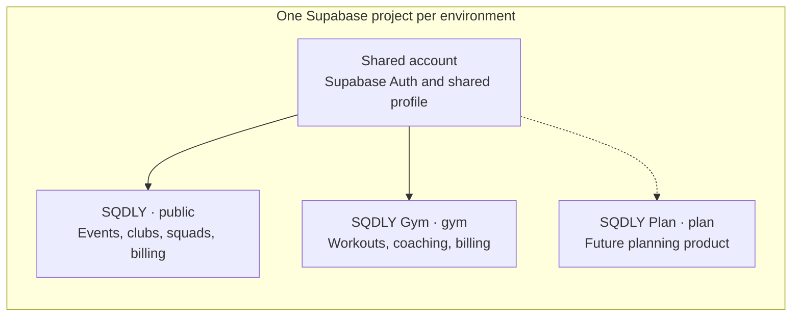

# SQDLY database architecture

SQDLY, Gym, and future Plan share an account. Each product owns its own data,
permissions, and releases. The diagram shows the target, with the existing
SQDLY schema labeled by its actual name.

- **Shared** owns login, the basic profile, and one stored profile image.
  A person can sign up in Gym and later use the same login in SQDLY.
- **Home location** is the location the person enters for themselves. SQDLY
  uses it as the starting point for nearby groups and squads. Gym will use
  the same home location for distances to gyms. A gym has its own location.
  The target mini profile shows only the person's home city, when known.
  The precise home location is private. The shared distance capability and
  Gym mini profile are planned.
- **Each product** owns its onboarding, memberships, permissions, and business
  data. A user can use one product independently of the others.
- **Live on Preview**, SQDLY reads and edits `public.profiles`. A database
  trigger copies the approved fields into `shared.profiles` in the same
  transaction. Gym reads its signed-in user's row through
  `public.get_my_shared_profile()`. The existing SQDLY editor remains the
  place to make profile edits during this stage.
- **Preview** is where we verify changes. Production is a separate project
  with its own database, accounts, and release step.
- **If a product retires or moves**, its data and services can be handled
  separately. The surviving product still needs the shared login and profile
  services. While hosted together, the products share database capacity.

See the [backend handover](backend-handover.md) for the Preview audit, rollout,
and separation plan. See the [user manual](user-manual.md) for the current
Preview sign-in workflow.
