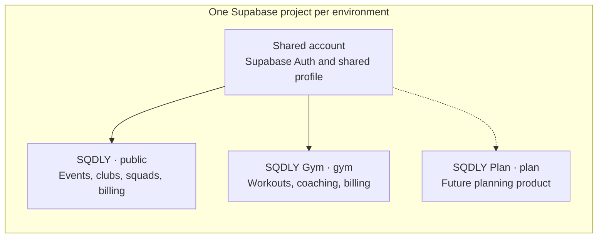

# SQDLY database architecture

SQDLY, Gym, and future Plan share an account. Each product owns its own data,
permissions, and releases. The diagram shows the target, with the existing
SQDLY schema labeled by its actual name.

- **Shared** owns login, the basic profile, and one stored profile image.
  A person can sign up in Gym and later use the same login in SQDLY.
- **Each product** owns its onboarding, memberships, permissions, and business
  data. A user can use one product independently of the others.
- **Today**, Gym development builds sign in against Preview and read the
  approved shared profile through a narrow interface over existing SQDLY
  records. Dedicated `shared` and `gym` schemas are later steps.
- **Preview** is where we verify changes. Production is a separate project
  with its own database, accounts, and release step.
- **If a product retires or moves**, its data and services can be handled
  separately. The surviving product still needs the shared login and profile
  services. While hosted together, the products share database capacity.

See the [backend handover](backend-handover.md) for the Preview audit, rollout,
and separation plan. See the [user manual](user-manual.md) for the current
Preview sign-in workflow.
